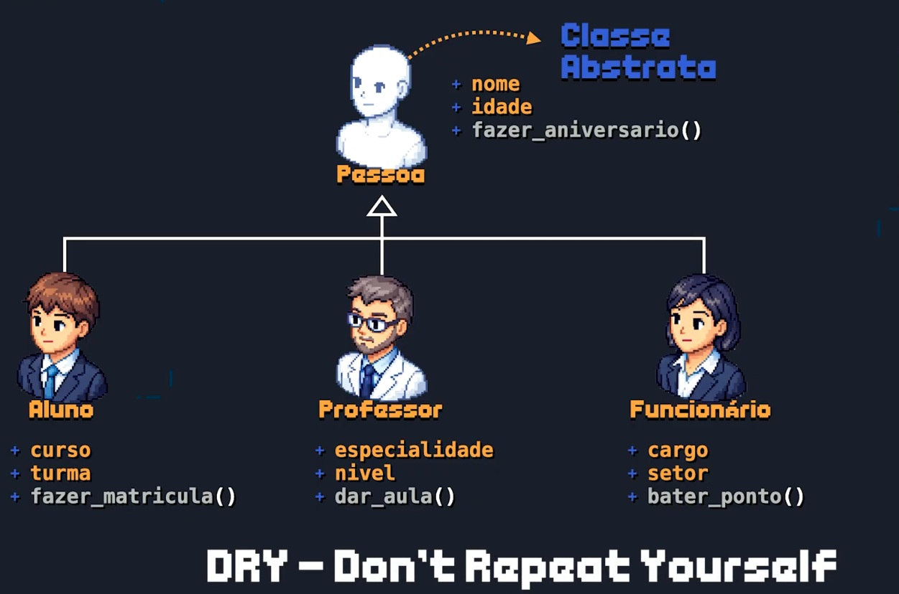

<h1 align="center">Revisão de Python</h1>

  <b>Revisão dos fundamentos de Python, com foco em boas práticas e organização de código.</b>

  
  
  
  
  

  <a href="#conteúdo">Conteúdo</a> ·
  <a href="exercicios/">Exercícios</a> ·
  <a href="#POO">POO</a>
  <a href="#diagrama-de-classes">Diagrama de classes</a>

---

## Conteúdo

### 1. Fundamentos de Python
- [x] Variáveis
- [x] Tipagem de dados
- [x] Entrada e saída (`input` / `print`)
- [x] Operações básicas
- [x] Resolução de desafio

### 2. TypeError, Type Check e Type Conversion
- [x] TypeError
- [x] `try` / `except`
- [x] Resolução de exercícios
- [x] Desafio com `try` / `except`

### 3. Estruturas de dados e controle de fluxo
- [x] `if`, `elif`, `else`
- [x] Listas e métodos
- [x] Tuplas
- [x] Dicionários
- [x] Loops (`for`, `while`)
- [x] `break` e `continue`
- [x] Exercícios (aulas 03 e 04)

### 4. Funções e arquivos
- [x] Funções
- [x] Docstrings e Annotations
- [x] Desafio de funções
- [x] Módulos
- [x] Lidando com arquivos

### 5. Mais sobre Python
- [x] List Comprehension

### 6. Tratamento de erros
- [x] `try`, `except`

### 7. Programação Orientada a Objetos
- [x] Classes
- [x] Objetos
- [x] Instâncias
- [x] Modularização
- [x] Herança
- [x] Abstração

## Diagrama de classes

  

## Exercícios

++30 exercícios resolvidos até o momento:

- [x] `Base Python`
- [x] `Estruturas de controle`
- [x] `for`
- [x] `while`
- [x] `Listas`
- [x] `Funções`
- [x] `zip`
- [x] `POO`

